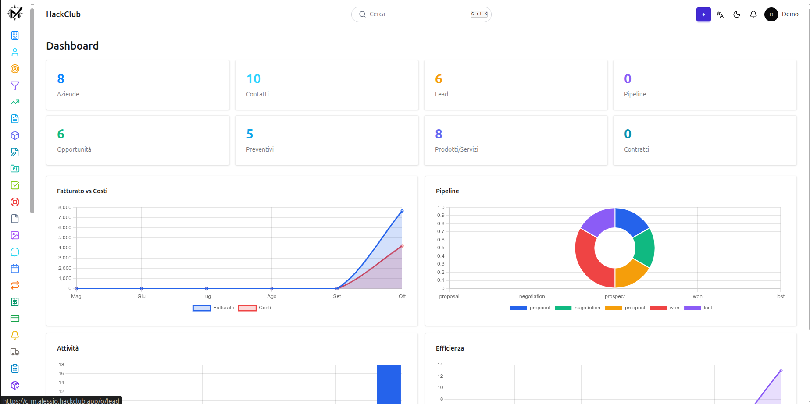
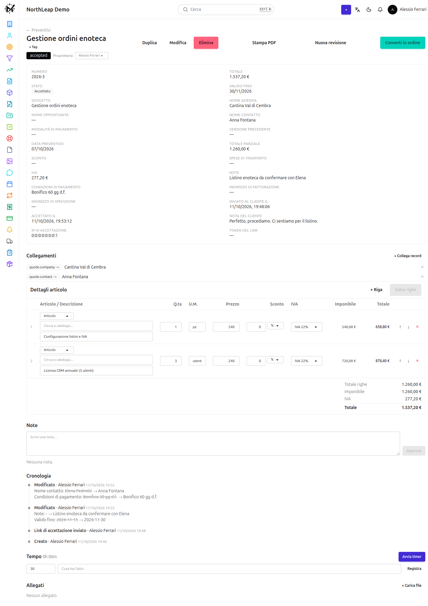
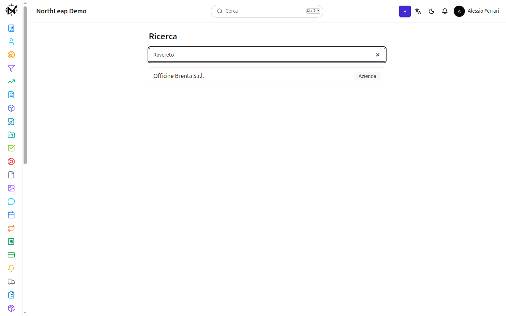
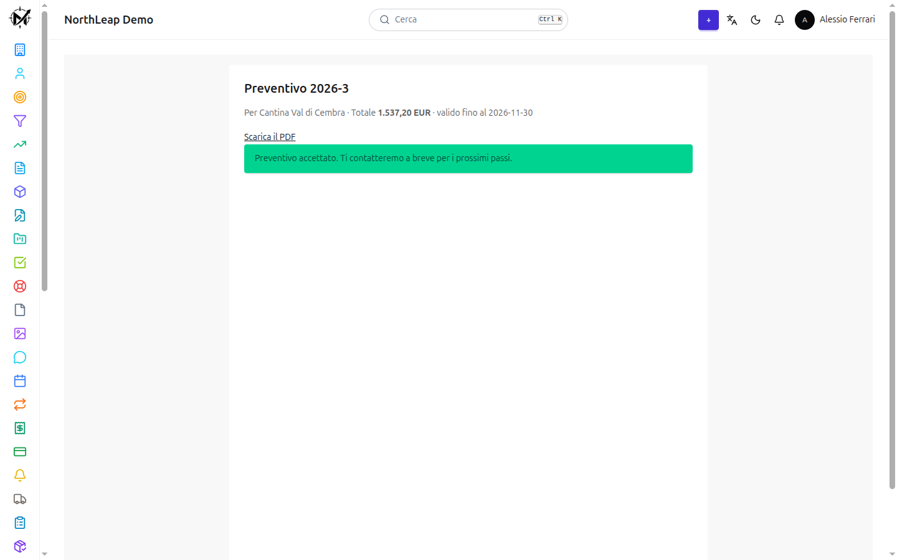
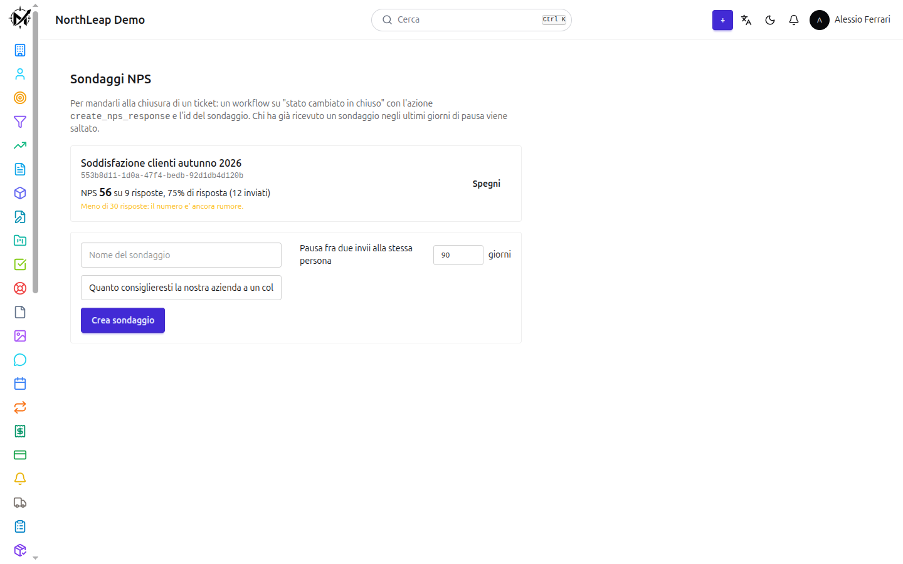

> **Heads up:** the interface is in Italian for now, and i18n is still on my to-do list. Until then, please use the built-in translate widget (bottom-left corner of the app) or your browser's translator. Sorry about that, and thank you!

<div align="center">

# CRM

**An open-source CRM for Italian small businesses: contacts, quotes and invoices with VAT, tickets, reports, workflows, e-invoicing and a customer portal.**

[Live demo](https://crm.alessio.hackclub.app) · [Screenshots](#screenshots) · [Quick start](#quick-start) · [Architecture](#architecture)




</div>

## Try it now

| | |
|---|---|
| **URL** | https://crm.alessio.hackclub.app |
| **Email** | `demo@northleap.it` |
| **Password** | `HackClub-Demo-2026!` |

The demo account is **read-only** (`viewer` role) and comes with realistic fake data: companies, contacts, quotes, invoices, tickets and campaigns. Outgoing email is switched off on the demo.
Sample data is preloaded so you can explore the CRM without first filling in dozens of fields.

## Features

- 🗂️ **Dynamic modules**: companies, contacts, leads, opportunities, tickets, projects, assets, todos and more. New modules and fields are configuration, not code.
- 🧾 **Quotes, orders and invoices** with line items, per-line and header discounts, shipping and **VAT by rate**. One service computes every total.
- 🖨️ **PDF generation** from editable HTML templates, with live preview on your last real document.
- 🇮🇹 **Italian e-invoicing (FatturaPA / SDI)** XML generation.
- ✍️ **Quote acceptance by signed link**: your customer accepts online, no account needed.
- 🧑‍💼 **Customer portal** for tickets and documents (separate login and token).
- 📧 **Email campaigns** with batching, open/click tracking and unsubscribe links.
- 📥 **Mail scanner**: IMAP mailboxes are turned into tickets, threads included.
- ⭐ **NPS surveys** with a public response form.
- ⚙️ **Workflow engine**: triggers, conditions and actions (email, webhooks with SSRF protection, field updates).
- 📊 **Dashboards and reports**: multi-tab dashboards, charts, a report builder, saved views.
- 🔎 **Full-text search** across every module (`pg_trgm`).
- 🏷️ **Tags, duplicate detection and merge, time tracking, trash and restore.**
- 🔐 **Roles and permissions** per module and action, with `OWN` / `TEAM` / `ALL` scope; **MFA (TOTP)**; **API keys**.
- 🤖 **MCP server**: let an AI assistant read your CRM through the Model Context Protocol, with a scoped API key.
- 🔔 **Real-time notifications** (SSE) and an **installable PWA**.
- 🔌 Webhooks in and out, Cal.com integration, audit log.

## Screenshots

| Quote with VAT lines | Full-text search |
|---|---|
|  |  |

| Customer accepts online | NPS survey |
|---|---|
|  |  |

## Architecture

There is no `contacts` or `companies` table. A single generic `Record` entity stores its fields in a `jsonb` column, and its `objectType` says what it is. 
The shape of each module is described by `ObjectType` and `FieldDef` rows (39 field types), so **adding a module needs no migration, only a configuration record**. One controller and one service serve all of them, and permissions are checked per module at runtime.

The only deliberate exceptions to the jsonb model are document lines (`document_line`) and totals: those are real columns because we sum them.

## Quick start

You need Docker.

```bash
git clone https://github.com/AlessioFerrari8/crm.git
cd crm
cp backend/.env.example backend/.env
# fill the secrets: openssl rand -base64 32  (a different one per line)
docker compose up -d --build
```

| Service | URL |
|---|---|
| App | http://localhost:4200 |
| API | http://localhost:8080 |
| Swagger | http://localhost:8080/swagger-ui.html |

The first time you open the app it shows **onboarding**: create your workspace and the first user, who becomes `owner`. The endpoint closes itself after first use.

### Run in development

```bash
docker compose up -d postgres-db
cd backend  && ./gradlew bootRun          # http://localhost:8080
cd frontend && npm install && npm start   # http://localhost:4200
```

## Configuration

Everything is in `backend/.env` (git-ignored); `backend/.env.example` is the template.
These have no default on purpose, because a secret in a repo is a public secret:

| Variable | Purpose |
|---|---|
| `JWT_ACCESS_SECRET` | signs access tokens (15 min) |
| `JWT_REFRESH_SECRET` | signs refresh tokens (30 days), must differ |
| `JWT_PORTAL_SECRET` | customer portal tokens, must differ |
| `QUOTE_ACCEPT_SECRET` | signs quote acceptance links |
| `MFA_SECRET_KEY` | encrypts secrets at rest (TOTP, IMAP passwords), 32 bytes base64 |
| `DB_USERNAME` / `DB_PASSWORD` | PostgreSQL credentials |


**Optional:** outgoing email (`MAIL_PROVIDER=smtp` or `resend`, plus `SMTP_*`), Cal.com webhook, Swagger (`SWAGGER_ENABLED=false` in production).
Without a mail provider everything works except sending: invitations, campaigns, NPS surveys and workflow emails.

## Tests

```bash
cd backend  && ./gradlew test      # needs Docker (Testcontainers)
cd frontend && npx ng build
```

Most tests are plain Mockito. The integration tests start a throwaway
`postgres:16-alpine` with Testcontainers.

## Security

- httpOnly cookie auth: tokens never appear in a response body.
- CSRF double-submit cookie; only signed webhooks and public forms are exempt.
- RBAC per resource and action, with `OWN` / `TEAM` / `ALL` scope.
- API keys are stored hashed and shown once.
- Per-IP rate limiting on login, refresh, invitations and webhooks.
- Upload hardening: blocked extensions, server-generated names, path checks.
- SSRF guard on workflow URLs: DNS is resolved and private, loopback and link-local addresses are refused.
- Secrets encrypted at rest.

## Under the hood

Things that look odd and are intentional:

- **jsonb columns are `Map` / `List`, never `JsonNode`.** Hibernate 7 uses Jackson 2 while Spring MVC uses Jackson 3; a library-specific type fails at runtime.
- **PDF views are classes, not `record`s.** Thymeleaf looks for `getX()`; a record exposes `x()` and the field silently renders empty.
- **Document totals have one owner**, `DocumentTotalService`, in this order: line, line discount, header discount, shipping, VAT by rate, total. The PDF and the e-invoice read those numbers, they never recompute.
- **Seeders have an explicit `@Order`** (1 Role … 7 Report): two equal values do not fail, they give a non-deterministic boot.
- **No Flyway.** Hibernate creates the schema (`ddl-auto=update`); new columns on populated tables need `@ColumnDefault`.
- **The backend image is built with `bootJar -x test`.** Run `./gradlew build` before `docker compose build`.

